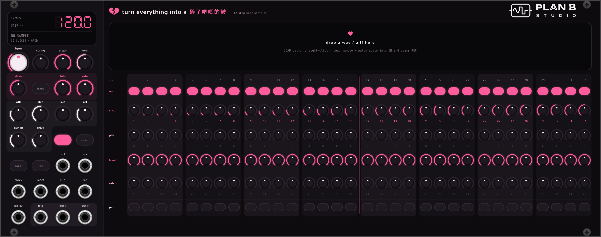

# turn everything into a 碎了吧唧的鼓 — 32 步切片采样器（VCV Rack 2 · Plan B Studio）

插件 slug：`PlanBStudio`，模块 slug：`Splinter`。开发者 Plan B Studio，GPL-3.0-or-later 开源。



把任意一段音频切成碎片，用 32 步音序器按 BPM 重新排列播放。每一步可以单独设定切片、音高、音量、连击次数，并在「正常播放」和「打击乐 ADSR」两种模式之间切换。目标是 IDM 里那种细碎、抽搐、颗粒感很强的鼓点。

## 安装 / 编译

```bash
make install
```

编译后会把 `PlanBStudio-2.3.0-mac-arm64.vcvplugin` 复制到 `~/Library/Application Support/Rack2/plugins-mac-arm64/`。**完全退出并重启 VCV Rack** 后，在模块浏览器里搜索 `碎了吧唧`、`turn everything` 或 `Splinter`（品牌 Plan B Studio）。模块宽 64HP。

> 2.1.0 从 16 步改成了 32 步，参数编号变了：用 2.0.0 存的 patch 里的每步设置会错位，需要重新设置。
> 2.2.0 只改了外观和显示名称（slug 仍是 `Splinter`）。
> 2.3.0 起插件 slug 从 `YiLao` 改成了 `PlanBStudio`（准备上架 VCV Library）：旧 patch 里的模块会显示为缺失，需要重新放一次。
> 2.3.0 起每步的 SLICE 直接记切片编号：用 2.1/2.2 存的 patch 打开后每步都会变成第 1 片，右键 →「切片按顺序」一键恢复成第 N 步 = 第 N 片。

- Rack SDK 2.6.6 已经放在 `Rack-SDK/`，也可以用 `make RACK_DIR=/其他/路径` 指定。
- 本机的 CommandLineTools 里有一个残缺的 `usr/include/c++/v1` 目录，会导致 `'string' file not found`。Makefile 已经自动绕过它；如果想彻底修好，可以重装 CommandLineTools。

## 采样来源

| 方式 | 操作 |
|---|---|
| 拖放 | 把 WAV / AIFF 文件直接拖到模块上 |
| LOAD 按钮 | 打开文件选择框 |
| 右键菜单 | 载入音频… / 清除采样 |
| 录音 | 把任意模块的音频接到 **IN L / IN R**，按 **REC**（或给 REC 输入一个触发）开始，再按一次停止 |

- 支持格式：WAV（8/16/24/32-bit 整数、32/64-bit 浮点、Extensible）、AIFF、AIFF-C。MP3/FLAC 请先转成 WAV。
- 录音长度（右键 → 录音长度）：「自由」最长 30 秒；「1/2/4 小节」会**等音序器走到第 1 步才开始**，录满自动停止，录下来的循环和网格严格对齐，非常适合把 patch 里的声音实时重采样再切碎。
- 载入的文件以路径保存在 patch 里；录音会以 `recording.wav` 存进 patch 自身的存储目录，跟着 patch 走。

## 面板说明

### 左侧：全局

| 控件 | 作用 |
|---|---|
| **BPM** | 速度 20–300。右键旋钮可以直接输入数值。每一步 = 1/16 音符（右键菜单可改 1/8、1/16T、1/32）；32 步 = 2 小节 |
| **SWING** | 50%（直）到 75%，把反拍的 16 分音符往后推 |
| **STEPS** | 序列长度 1–32，超出长度的步会被压暗。用来做奇数拍循环、复合节拍 |
| **LEVEL** | 输出电平 |
| **SLICES** | 切片数 1–64（默认 32）：**切片精度**，切得越多，碎片越短 |
| **TRANS** | 按钮灭 = 等分网格切片；亮 = **瞬态检测切片**（自动找鼓的起音点，适合不规则的 break） |
| **BITS** | 位深 16 → 1 bit：**采样精度**，往左转越来越脏 |
| **RATE** | 降采样（采样保持），从原始采样率一直降到约 1/128 |
| **ATK / DEC / SUS / REL** | 打击乐模式的 ADSR（起音 0.2–100ms，衰减/释放 5ms–2s） |
| **PUNCH** | 打击乐模式的音高冲击：起音瞬间音高抬高最多 24 半音再迅速落回，给任何声音加上「鼓皮」般的冲击 |
| **DRIVE** | 打击乐模式的饱和，把声音压得更密、更硬 |
| **RUN / RESET** | 运行开关 / 回到第 1 步 |

### 右侧：32 步（每一列是一步，每 4 步一组，第 16/17 步之间有分隔线）

旋钮外圈的发光弧线就是当前数值（PITCH 从正中向两边走）。正在播放的那一列会有粉色高亮，步号下面挂一颗小粉心。

| 行 | 作用 |
|---|---|
| **ON** | 这一步是否发声。**按住拖过多个格子可以一次刷开/刷关** |
| **SLICE** | 播放哪一片（切片编号 1–64，转一格换一片，右键旋钮可以直接输入编号）。**默认 32 片、第 N 步 = 第 N 片**，需要时再手动改。编号大于当前切片数会绕回来（例如 16 片时 20 号 = 第 4 片），所以改 SLICES 不会打乱已经设好的顺序。下方数字是实际播放的切片 |
| **PITCH** | ±24 半音（按半音吸附），通过变速实现：降调会变长变暗，升调会变短变尖 |
| **LEVEL** | 这一步的音量 |
| **RATCH** | 连击 1–8 次：在这一步里均匀重复触发，IDM 碎拍和 buzz roll 的关键 |
| **PERC** | 格子灭 = **正常播放**（原样播放整片）；亮白色 = **打击乐模式**（饱和 → ADSR → 音高冲击）。同样可以拖动连刷 |

切片是单音的：新的触发会让上一个声音在 3ms 内淡出（choke）。快速连击时这种「掐断」正是碎拍质感的来源，同时每个切片的头尾都有极短的淡入淡出，防止爆音。

### 接口

| 接口 | 作用 |
|---|---|
| CLOCK | 外部时钟，**每个脉冲走一步**（接上后忽略 BPM 旋钮，显示屏显示 EXT 和测得的 BPM） |
| RESET / RUN / REC | 触发输入：复位 / 运行切换 / 录音切换 |
| IN L / IN R | 录音输入（只接 L 时录单声道） |
| SLC CV | 切片偏移：0–10V 把所有步的切片整体往后推一整圈，接随机或 LFO 就是自动打乱 |
| TRIG | 每次触发（包括连击）输出 1ms 触发，可以去触发别的模块 |
| OUT L / OUT R | 音频输出（±5V） |

## 做 IDM 碎拍的几个起点

1. 载入一段 breakbeat，打开 **TRANS**，SLICES 设 16–32：每一片就是一个鼓击。
2. **Ctrl/Cmd+R** 是专门调过的「IDM 随机」：只改每一步的参数（切片、少量连击、部分步打击乐模式、偶尔的八度/五度移调），不会动 BPM 和包络。不满意就再按一次，或 Ctrl+Z 撤销。
3. 在几步上开 RATCH 6–8 + PERC 模式 + 短 DEC（20–40ms），就是 Aphex / Squarepusher 式的机关枪连击。
4. PUNCH 拉高 + DEC 很短：任何素材（人声、pad、噪声）都会变成带「啵」声的电子鼓。
5. 把一个随机 / 采样保持模块接到 **SLC CV**，切片顺序会一直在变。
6. STEPS 设成 7、11、13、27，再和另一台音序器一起跑，得到不断错位的复合节奏。
7. 右键菜单把每步时值改成 1/32：32 步正好 1 小节，配合连击可以写出非常密的碎拍。
8. BITS 6–8 + RATE 往左一点点，就是 90 年代采样器的颗粒感。

## 文件结构

```
src/Splinter.cpp     模块：音序器、发声、打击乐包络、录音、界面
src/SampleData.*     波形概览、瞬态检测、切片计算
src/AudioFile.*      WAV / AIFF 读取，WAV 写入（无第三方依赖）
res/Splinter.svg     面板底图 + Plan B logo（由 tools/make_panel.py 生成）
res/knob-*.svg       旋钮底座和指针
tools/make_panel.py  生成面板和旋钮 SVG；改布局时和 src/Splinter.cpp 顶部的坐标一起改
```

面板文字、显示屏、旋钮弧线和按钮都在代码里用 nanovg 绘制（Rack 的 SVG 渲染器不支持文字）；中文标题用 Rack 自带的 Noto Sans SC。

配色是黑 / 粉 / 白：底色莓紫黑 `#0D0B0E`，主色热粉 `#FF5C9E`（音序、切片），白 `#FFF6FA`（打击乐模式相关），浅粉 `#FFB1CF`（音高、连击等次要数值）。改颜色要同时改 `tools/make_panel.py` 顶部和 `src/Splinter.cpp` 的 `COL_*` 常量。Plan B logo 用官方纸白版。

## 许可

源代码以 [GPL-3.0-or-later](LICENSE-GPLv3.txt) 开源。Plan B Studio 名称和 logo 不随代码授权，衍生作品不能使用。螺丝和插孔图形来自 VCV Component Library（CC BY-NC 4.0）。详见 [LICENSE.md](LICENSE.md)。

## 发布到 VCV Library

1. 推送到 GitHub 后，`.github/workflows/build.yml` 会自动在 Windows / Linux / macOS（Intel + Apple Silicon）上编译，在仓库的 Actions 页面确认全部通过。
2. 在 https://github.com/VCVRack/library/issues 新开一个 issue，标题写 `PlanBStudio`，正文写源代码地址、版本号和 commit hash。
3. 以后更新：plugin.json 的 version 加一 → 推送 → 在同一个 issue 里回复新版本号和 commit hash。
